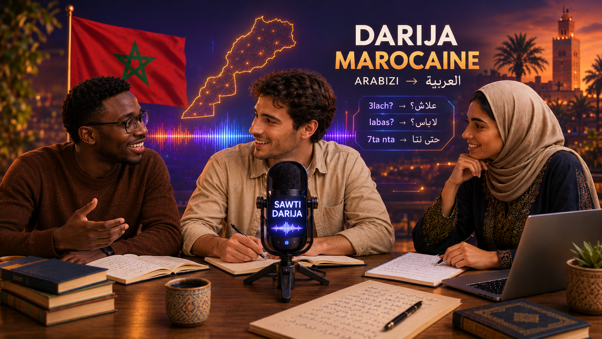

# ByT5-Arabizi-Normalizer

*Normalisation de l'arabizi marocain vers l'écriture arabe avec ByT5*

[](https://byt5-arabizi-normalizer.readthedocs.io/)


## Introduction

<p align="center">
  
</p>

### Contexte

Le darija est la langue de communication quotidienne au Maroc, mais il est peu écrit de façon formelle. Sur les réseaux sociaux et les messageries, il est très souvent écrit en **arabizi** : des lettres latines complétées par des chiffres qui représentent des sons absents du latin (`3` pour ع, `7` pour ح, `9` pour ق). Cette écriture n'a pas de norme : chacun écrit comme il prononce, selon ses habitudes et son clavier.

Or la plupart des outils de traitement automatique de l'arabe attendent de l'écriture arabe, et les ressources disponibles pour le darija sont bien plus rares que pour l'arabe standard ou le français. Tant que ces messages restent en arabizi, ils sont difficiles à exploiter.

### Problématique

> **Comment convertir de façon fiable un message en arabizi marocain, bruité et non standardisé, y compris lorsqu'il mêle du français, vers du darija écrit en caractères arabes, alors que les données parallèles disponibles sont peu nombreuses, hétérogènes et en grande partie synthétiques ?**

Quatre difficultés rendent la tâche non triviale :

- **Une écriture sans norme.** Un même mot s'écrit de plusieurs façons (`merci`, `mersi`, `mrc`), et un même caractère latin peut correspondre à plusieurs lettres arabes : `ga3` s'écrit ڭاع alors que `ghanmchiw` s'écrit غانمشيو.
- **Une cible elle aussi variable.** L'orthographe du darija en caractères arabes n'est pas standardisée : dans `Haitam03/doda_synthetic`, `ngoulik` apparaît sous la forme نڭوليك dans la sortie brute d'un modèle et نقوليك dans la version corrigée. Il faut fixer une convention.
- **Le mélange avec le français.** Les locuteurs insèrent des mots et expressions françaises (`l'adresse`, `stp`, `application`) qu'un modèle ne connaissant pas ces cas risque de déformer.
- **Des données limitées et inégales.** Les sources existantes ont des conventions différentes, plus de 90 % des lignes collectées sont synthétiques, et il n'existe pas de jeu de test réel.

### Ce que nous construisons

**Un corpus de paires darija arabe ↔ arabizi**, rassemblé à partir de sources publiques puis enrichi :

- un **lexique de mots français fréquents**, par domaine (santé, technologie, administration, banque, école, commerce, etc.), avec leurs variantes d'écriture latine et leur forme en écriture arabe ;
- des **phrases mixtes darija / français** générées à partir de ce lexique, avec la version en écriture arabe correspondante, et du bruit réaliste sur l'arabizi (apostrophes oubliées, voyelles supprimées, chiffres variables) ;
- un **Nouveau Testament en darija**, traduit depuis le français (texte Louis Segond 1910, dans le domaine public) par un modèle de langage, puis validé par un second modèle ;
- un **jeu de test réel**, relu à la main et jamais utilisé pour générer des données d'entraînement.

**Un modèle de normalisation** basé sur **ByT5**, utilisé en séquence-à-séquence : il reçoit une phrase en arabizi et produit la phrase correspondante en darija écrit en caractères arabes. ByT5 traite le texte octet par octet, sans vocabulaire fermé : une faute de frappe, une variante d'orthographe ou un mot français jamais vu ne sont pas « hors vocabulaire ». Il sera évalué sur le jeu de test réel (taux d'erreur de caractères, correspondance exacte), avec une analyse d'erreurs par source et par type de phrase.

Le projet normalise l'écriture ; il ne cherche pas à traduire le darija, ni à identifier le dialecte.

> **Statut.** Les cinq sources sont extraites, unifiées et fusionnées en un corpus nettoyé. Le lexique, les phrases mixtes, le jeu de test et l'entraînement du modèle restent à réaliser.

## Données

| Source | Lignes | Nature |
|---|---|---|
| [`DrIAmed/darija-youtube-dataset`](https://huggingface.co/datasets/DrIAmed/darija-youtube-dataset) | 2 706 | Transcriptions de vidéos YouTube |
| [`MBZUAI-Paris/DODa-10K`](https://huggingface.co/datasets/MBZUAI-Paris/DODa-10K) | 10 000 | Corpus de référence |
| [`OiQ/daa-pairs`](https://huggingface.co/datasets/OiQ/daa-pairs) | 112 814 | Synthétique (généré par LLM) |
| [`Haitam03/doda_synthetic`](https://huggingface.co/datasets/Haitam03/doda_synthetic) | 64 260 | Synthétique, arabizi bruité |
| [`atlasia/DODa-audio-dataset-V3`](https://huggingface.co/datasets/atlasia/DODa-audio-dataset-V3) | 11 517 | Transcriptions d'enregistrements |
| **Total (avant nettoyage)** | **201 297** | |
| **Après fusion et nettoyage** | **196 770** | |

Chaque fichier produit suit le même schéma :

| Colonne | Contenu |
|---|---|
| `id` | Identifiant unique, préfixé selon la source |
| `darija` | Phrase en écriture arabe |
| `transliteration` | La même phrase en arabizi |
| `source` | Jeu de données d'origine |

Le corpus est publié sur Hugging Face : <https://huggingface.co/datasets/sawti-nlp/darija-arabizi-corpus>
(dépôt privé pour l'instant ; l'accès doit être accordé aux encadrants, ou le dépôt passé en public.)

## Structure du dépôt

```
.
├── Extractor/
│   ├── extract_darija.py           # DrIAmed/darija-youtube-dataset
│   ├── extract_doda.py             # MBZUAI-Paris/DODa-10K
│   ├── extract_daa_pairs.py        # OiQ/daa-pairs
│   ├── extract_doda_synthetic.py   # Haitam03/doda_synthetic
│   └── seed_lexicon.py             # amorce du lexique de mots français
├── merge_all.py                    # fusion, nettoyage, dédoublonnage
├── make_splits.py                  # jeu de test et découpage train / dev
├── baseline.py                     # baseline déterministe (règles + table de mots)
├── evaluate.py                     # métriques, commande unique et reproductible
├── test_robustesse.py              # contrôle de recette ENF-08
├── requirements.txt                # versions épinglées
├── docs/                           # documentation (Sphinx, Read the Docs)
├── .readthedocs.yaml
└── .gitignore
```

## Fusion et nettoyage

`merge_all.py` empile les cinq fichiers et produit `darija_all.csv`. Il retire les
lignes vides, les consignes de génération restées dans la cible et les doublons de
paires, puis ajoute des colonnes de contrôle. Le texte lui-même n'est pas réécrit :
seuls les espaces sont normalisés, car c'est ce texte qui servira à l'entraînement.

| Colonne ajoutée | Contenu |
|---|---|
| `key_ar`, `key_la` | Clés de comparaison : ponctuation, vocalisation et variantes de lettres neutralisées |
| `conflit` | Un même arabizi reçoit des cibles arabes divergentes selon la source |
| `suspect` | Les deux côtés de la paire ne se correspondent manifestement pas |

Les lignes marquées sont **conservées** et non supprimées. Deux cas ne se traitent
pas de la même façon : une même phrase arabe écrite de plusieurs façons en arabizi
est la variation que le modèle doit apprendre, alors qu'un même arabizi associé à
des cibles divergentes est une incohérence entre conventions de sources. L'arbitrage
du second cas dépend de la convention orthographique encore à fixer.

## Jeu de test et découpage

`make_splits.py` produit `train.csv` (186 861 lignes), `dev.csv` (9 799) et
`test_real.csv` (850), et garantit trois choses :

- **Le jeu de test est [`atlasia/TerjamaBench`](https://huggingface.co/datasets/atlasia/TerjamaBench)**, seul arabizi écrit par des humains dont nous disposons, le reste du corpus étant à plus de 90 % produit par des modèles. Il est réservé à l'évaluation.
- **Aucune phrase ne traverse deux blocs.** Le découpage porte sur la clé de phrase et non sur les lignes, et 110 lignes du corpus qui recoupaient le jeu de test ont été retirées.
- **Le `dev` ne contient aucune référence ambiguë**, puisqu'il sert à la mise au point.

Une colonne `darija_norm` s'ajoute : la cible débarrassée de la vocalisation,
avec le point d'interrogation en arabe. `darija` reste intact à côté. Ces deux
écarts représentaient 27 % des cibles d'entraînement contre 0,7 % de celles du
jeu de test, donc autant d'erreurs de caractères sans erreur de langue.

Les limites du jeu de test, sa taille et la discipline de son usage sont décrites
dans la [documentation](https://byt5-arabizi-normalizer.readthedocs.io/).

## Démarrage rapide

```bash
git clone https://github.com/SouleymaneDiallo04/ByT5-Arabizi-Normalizer
cd ByT5-Arabizi-Normalizer
python -m pip install -r requirements.txt

python Extractor/extract_darija.py
python Extractor/extract_doda.py
python Extractor/extract_daa_pairs.py
python Extractor/extract_doda_synthetic.py

python merge_all.py
python make_splits.py

python baseline.py
python evaluate.py
```

Les scripts lisent à distance uniquement les colonnes de texte des fichiers Parquet : il n'est pas nécessaire de télécharger les jeux de données complets (l'un d'eux pèse environ 475 Mo à cause de l'audio). Résultat : un fichier CSV par source, puis `darija_all.csv` pour le corpus fusionné.

> `atlasia/DODa-audio-dataset-V3` n'a pas encore de script d'extraction : son CSV se récupère depuis le dépôt Hugging Face. `merge_all.py` signale les fichiers absents et poursuit avec les autres.

> Sous Windows, si le chemin utilisateur contient un espace, utiliser `python -m pip install ...` plutôt que `pip install ...`.

## Baseline et évaluation

La baseline est le plancher que le modèle doit dépasser. Elle n'apprend rien :
une table de correspondance de mots extraite du corpus d'entraînement, puis une
conversion caractère par caractère pour les mots qu'elle ignore.

| Système | CER | Exactitude phrase |
|---|---:|---:|
| Règles seules, aucune donnée | 0,2224 | 9,6 % |
| **Règles + table apprise sur le train** | **0,1735** | **18,2 %** |

C'est contre **0,1735** que ByT5 doit être comparé, les deux utilisant les mêmes
données. L'écart mesurera ce que le modèle apporte au-delà d'une recherche dans
un dictionnaire.

Les métriques sont produites par une **commande unique**, `evaluate.py`, qui
servira aussi au modèle et aux modèles publics de comparaison. Le détail des
résultats, par thème et par variété régionale, est dans la
[documentation](https://byt5-arabizi-normalizer.readthedocs.io/).

## Documentation

La documentation complète est disponible sur Read the Docs : <https://byt5-arabizi-normalizer.readthedocs.io/>

Pour la construire en local :

```bash
python -m pip install -r docs/requirements.txt
python -m sphinx -b html docs docs/_build/html
```

## Limites connues

- Les conventions d'arabizi diffèrent selon les sources (la colonne `source` permet de les séparer).
- Les données synthétiques n'ont pas été relues exhaustivement par des locuteurs natifs.
- Pas encore de jeu de test réel, ni de phrases mêlant darija et français.

## Feuille de route

- [x] Extraction et unification de cinq sources
- [x] Carte du dataset et documentation initiale
- [x] Fusion et nettoyage du corpus (`merge_all.py`)
- [ ] Lexique de mots français fréquents et phrases mixtes darija / français
- [ ] Nouveau Testament en darija (génération puis validation)
- [x] Jeu de test et découpage sans fuite (`make_splits.py`)
- [x] Baseline déterministe et harnais d'évaluation
- [ ] Jeu de contrôle d'arabizi réel de messagerie, annoté à la main
- [ ] Entraînement et évaluation du modèle ByT5

## Contributeurs

- **Hinimdou Morsia Guitdam**
- **Souleymane Diallo**

## Licence

Le corpus fusionné suit la licence la plus restrictive de ses sources, **CC BY-NC 4.0** (usage non commercial). Consulter la licence de chaque jeu de données d'origine avant toute réutilisation. La licence du code reste à définir.

## Remerciements

Ce travail repose sur les jeux de données publiés par `DrIAmed`, `MBZUAI-Paris`, `OiQ` et `Haitam03` sur Hugging Face.
