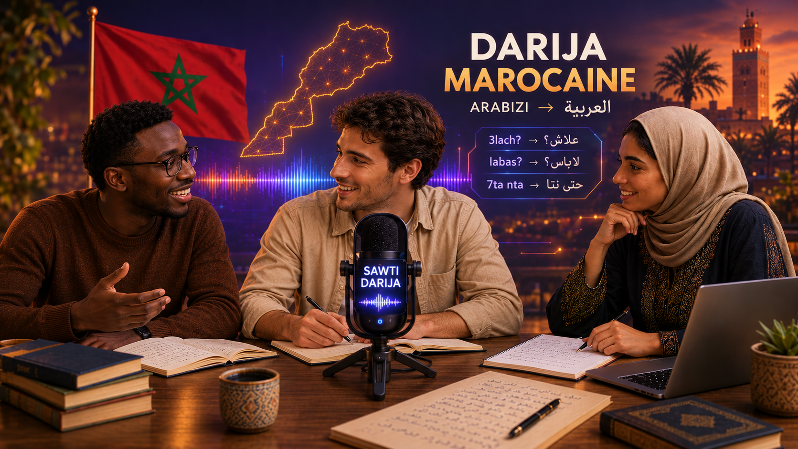

# ByT5-Arabizi-Normalizer

*Normalisation de l'arabizi marocain vers l'écriture arabe avec ByT5*

[](https://byt5-arabizi-normalizer.readthedocs.io/)


## Introduction
## Introduction

<p align="center">
  
</p>

### Contexte
### Contexte

Le darija est la langue de communication quotidienne au Maroc, mais il est peu écrit de façon formelle. Sur les réseaux sociaux et les messageries, il est très souvent écrit en **arabizi** : des lettres latines complétées par des chiffres qui représentent des sons absents du latin (`3` pour ع, `7` pour ح, `9` pour ق). Cette écriture n'a pas de norme : chacun écrit comme il prononce, selon ses habitudes et son clavier.

Or la plupart des outils de traitement automatique de l'arabe attendent de l'écriture arabe, et les ressources disponibles pour le darija sont bien plus rares que pour l'arabe standard ou le français. Tant que ces messages restent en arabizi, ils sont difficiles à exploiter.

### Problématique

> **Comment convertir de façon fiable un message en arabizi marocain, bruité et non standardisé, y compris lorsqu'il mêle du français, vers du darija écrit en caractères arabes, alors que les données parallèles disponibles sont peu nombreuses, hétérogènes et en grande partie synthétiques ?**

Quatre difficultés rendent la tâche non triviale :

- **Une écriture sans norme.** Un même mot s'écrit de plusieurs façons (`merci`, `mersi`, `mrc`), et un même caractère latin peut correspondre à plusieurs lettres arabes : `ga3` s'écrit ڭاع alors que `ghanmchiw` s'écrit غانمشيو.
- **Une cible elle aussi variable.** L'orthographe du darija en caractères arabes n'est pas standardisée : dans `Haitam03/doda_synthetic`, `ngoulik` apparaît sous la forme نڭوليك dans la sortie brute d'un modèle et نقوليك dans la version corrigée. Il faut fixer une convention.
- **Le mélange avec le français.** Les locuteurs insèrent des mots et expressions françaises (`l'adresse`, `stp`, `application`) qu'un modèle ne connaissant pas ces cas risque de déformer.
- **Des données limitées et inégales.** Les sources existantes ont des conventions différentes, plus de 90 % des lignes collectées sont synthétiques, et il n'existe pas de jeu de test réel.

### Ce que nous construisons

**Un corpus de paires darija arabe ↔ arabizi**, rassemblé à partir de sources publiques puis enrichi :

- un **lexique de mots français fréquents**, par domaine (santé, technologie, administration, banque, école, commerce, etc.), avec leurs variantes d'écriture latine et leur forme en écriture arabe ;
- des **phrases mixtes darija / français** générées à partir de ce lexique, avec la version en écriture arabe correspondante, et du bruit réaliste sur l'arabizi (apostrophes oubliées, voyelles supprimées, chiffres variables) ;
- un **Nouveau Testament en darija**, traduit depuis le français (texte Louis Segond 1910, dans le domaine public) par un modèle de langage, puis validé par un second modèle ;
- un **jeu de test réel**, relu à la main et jamais utilisé pour générer des données d'entraînement.

**Un modèle de normalisation** basé sur **ByT5**, utilisé en séquence-à-séquence : il reçoit une phrase en arabizi et produit la phrase correspondante en darija écrit en caractères arabes. ByT5 traite le texte octet par octet, sans vocabulaire fermé : une faute de frappe, une variante d'orthographe ou un mot français jamais vu ne sont pas « hors vocabulaire ». Il sera évalué sur le jeu de test réel (taux d'erreur de caractères, correspondance exacte), avec une analyse d'erreurs par source et par type de phrase.

Le projet normalise l'écriture ; il ne cherche pas à traduire le darija, ni à identifier le dialecte.

> **Statut.** Les quatre sources sont extraites et unifiées. Le lexique, les phrases mixtes, le jeu de test et l'entraînement du modèle restent à réaliser.

## Données

| Source | Lignes | Nature |
|---|---|---|
| [`DrIAmed/darija-youtube-dataset`](https://huggingface.co/datasets/DrIAmed/darija-youtube-dataset) | 2 706 | Transcriptions de vidéos YouTube |
| [`MBZUAI-Paris/DODa-10K`](https://huggingface.co/datasets/MBZUAI-Paris/DODa-10K) | 10 000 | Corpus de référence |
| [`OiQ/daa-pairs`](https://huggingface.co/datasets/OiQ/daa-pairs) | 112 814 | Synthétique (généré par LLM) |
| [`Haitam03/doda_synthetic`](https://huggingface.co/datasets/Haitam03/doda_synthetic) | 64 260 | Synthétique, arabizi bruité |
| **Total (avant nettoyage)** | **189 780** | |

Chaque fichier produit suit le même schéma :

| Colonne | Contenu |
|---|---|
| `id` | Identifiant unique, préfixé selon la source |
| `darija` | Phrase en écriture arabe |
| `transliteration` | La même phrase en arabizi |
| `source` | Jeu de données d'origine |

Le corpus est publié sur Hugging Face : <lien-Hugging-Face>

## Structure du dépôt

```
.
├── extract_darija.py            # DrIAmed/darija-youtube-dataset
├── extract_doda.py              # MBZUAI-Paris/DODa-10K
├── extract_daa_pairs.py         # OiQ/daa-pairs
├── extract_doda_synthetic.py    # Haitam03/doda_synthetic
├── merge_all.py                 # fusion, nettoyage, dédoublonnage
├── docs/                        # documentation (Sphinx, Read the Docs)
└── .readthedocs.yaml
```

## Démarrage rapide

```bash
git clone https://github.com/SouleymaneDiallo04/ByT5-Arabizi-Normalizer
cd ByT5-Arabizi-Normalizer
python -m pip install pandas pyarrow requests huggingface_hub

python extract_darija.py
python extract_doda.py
python extract_daa_pairs.py
python extract_doda_synthetic.py
python merge_all.py
```

Les scripts lisent à distance uniquement les colonnes de texte des fichiers Parquet : il n'est pas nécessaire de télécharger les jeux de données complets (l'un d'eux pèse environ 475 Mo à cause de l'audio). Résultat : un CSV par source, plus `darija_all.csv` pour le corpus fusionné.

> Sous Windows, si le chemin utilisateur contient un espace, utiliser `python -m pip install ...` plutôt que `pip install ...`.

## Documentation

La documentation complète est disponible sur Read the Docs : <https://byt5-arabizi-normalizer.readthedocs.io/>

Pour la construire en local :

```bash
python -m pip install -r docs/requirements.txt
python -m sphinx -b html docs docs/_build/html
```

## Limites connues

- Les conventions d'arabizi diffèrent selon les sources (la colonne `source` permet de les séparer).
- Les données synthétiques n'ont pas été relues exhaustivement par des locuteurs natifs.
- Pas encore de jeu de test réel, ni de phrases mêlant darija et français.

## Feuille de route

- [x] Extraction et unification de quatre sources
- [x] Carte du dataset et documentation initiale
- [ ] Fusion et nettoyage du corpus
- [ ] Lexique de mots français fréquents et phrases mixtes darija / français
- [ ] Nouveau Testament en darija (génération puis validation)
- [ ] Jeu de test réel relu à la main
- [ ] Entraînement et évaluation du modèle ByT5

## Contributeurs

- **Hinimdou Morsia Guitdam**
- **Souleymane Diallo**

## Licence

Le corpus fusionné suit la licence la plus restrictive de ses sources, **CC BY-NC 4.0** (usage non commercial). Consulter la licence de chaque jeu de données d'origine avant toute réutilisation. La licence du code reste à définir.

## Remerciements

Ce travail repose sur les jeux de données publiés par `DrIAmed`, `MBZUAI-Paris`, `OiQ` et `Haitam03` sur Hugging Face.