# Modèle

```{note}
Nous commencerons par confronter différentes architectures et méthodes existantes afin d'identifier l'approche la plus performante. 

Avant toute chose, juste après l'établissement de la baseline, nous allons procéder au fine-tuning direct du modèle **`google/byt5-small`**. Le choix de ce modèle s'explique par sa rapidité d'inférence : notre objectif actuel étant de concilier une inférence rapide et des performances élevées, `byt5-small` constitue un candidat idéal. 

Par ailleurs, ce fine-tuning ne sera pas réalisé de manière standard : nous utiliserons une méthode d'adaptation avancée bas-rang (**LoRA**) couplée à une double quantification (**QLoRA** - 4-bit) afin d'optimiser et d'économiser l'utilisation de la VRAM de manière rigoureuse et scientifique.

### Configuration du modèle pour l'entraînement QLoRA

Pour charger correctement le modèle **ByT5** et préparer son entraînement avec la méthode **QLoRA**, la configuration suivante est indispensable.

```python
import torch
from transformers import (
    AutoModelForSeq2SeqLM,
    ByT5Tokenizer,
    BitsAndBytesConfig
)
from peft import prepare_model_for_kbit_training

MODEL_NAME = "google/byt5-small"  # ou "google/byt5-base"

# Sélection automatique du type de précision
USE_BF16 = torch.cuda.is_available() and torch.cuda.is_bf16_supported()
COMPUTE_DTYPE = torch.bfloat16 if USE_BF16 else torch.float16

print("Compute dtype :", COMPUTE_DTYPE)

# Configuration de la quantification 4 bits
bnb_config = BitsAndBytesConfig(
    load_in_4bit=True,
    bnb_4bit_quant_type="nf4",
    bnb_4bit_use_double_quant=True,
    bnb_4bit_compute_dtype=COMPUTE_DTYPE,
)

# Chargement du tokenizer
tokenizer = ByT5Tokenizer.from_pretrained(MODEL_NAME)

# Chargement du modèle quantifié
model = AutoModelForSeq2SeqLM.from_pretrained(
    MODEL_NAME,
    quantization_config=bnb_config,
    device_map={"": 0},  # Un seul GPU
)

# Préparation du modèle pour QLoRA
model.config.use_cache = False

model = prepare_model_for_kbit_training(
    model,
    use_gradient_checkpointing=True
)

print(type(model).__name__, "| pad_token_id =", tokenizer.pad_token_id)
print(f"Mémoire modèle : {model.get_memory_footprint()/1e6:.1f} MB")
```

**Remarques techniques :**
- La quantification NF4 réduit la mémoire nécessaire au chargement du modèle.
- Le double quantification réduit davantage le coût mémoire.
- BF16 est utilisé lorsque le GPU le prend en charge, sinon FP16.
- `prepare_model_for_kbit_training` prépare le modèle quantifié pour l'entraînement avec PEFT.
- Le gradient checkpointing permet de réduire la consommation mémoire au prix d'un temps de calcul supplémentaire.

Pour comprendre l'ensemble de la configuration, les choix techniques et les étapes d'entraînement, veuillez consulter le **notebook officiel de l'entraînement QLoRA**, qui contient l'implémentation complète et les explications associées.


## Architecture

À compléter : variante de ByT5 utilisée, taille, configuration.

## Entraînement

### Entraînement et fusion des adaptateurs

Pour l'entraînement, nous allons éviter de vous encombrer avec les différents codes Python. Nous procéderons plutôt à un **fine-tuning séquentiel avec plusieurs adaptateurs**, chaque adaptateur étant entraîné sur une source de données spécifique.

Les différentes sources sont réparties comme suit :

- Source 1 : 1 289 exemples
- Source 2 : 2 276 exemples
- Source 3 : 106 452 exemples
- Source 4 : 54 433 exemples
- Source 5 : 743 exemples
- Test clean : 834 exemples

Chaque source possède donc son propre adaptateur, entraîné successivement. À la fin, le modèle final sera obtenu par **fusion des différents adaptateurs**, à travers une sommation pondérée de leurs poids :

### Formule de fusion des adaptateurs

Chaque source possède donc son propre adaptateur, entraîné successivement. À la fin, le modèle final sera obtenu par **fusion des différents adaptateurs**, à travers une sommation pondérée de leurs poids :

<div align="center">

**W_final = W₀ + α₁ΔW₁ + α₂ΔW₂ + α₃ΔW₃ + α₄ΔW₄ + α₅ΔW₅**

</div>

où :

- **W₀** représente les poids du modèle de base.
- **ΔWᵢ** représente la mise à jour des poids apportée par le i-ème adaptateur.
- **αᵢ** représente le coefficient de pondération associé à chaque adaptateur.

Le jeu `test_clean` (834 exemples) sera réservé à l'évaluation finale du modèle fusionné.


### Deuxième approche : entraînement d'un seul adaptateur LoRA sur toutes les sources

Dans cette deuxième approche, nous adoptons une stratégie différente qui consiste à entraîner **un seul adaptateur LoRA à partir de l'ensemble des cinq sources de données**, regroupées dans un corpus commun.

L'objectif est de permettre à un adaptateur unique d'apprendre les caractéristiques de toutes les sources au cours d'un même processus d'entraînement.

La formulation mathématique de cette approche est la suivante :

<div align="center">

**W_final = W₀ + ΔW_global**

</div>

où :

- **W₀** représente les poids du modèle de base.
- **ΔW_global** représente la mise à jour des poids apportée par l'unique adaptateur LoRA entraîné sur l'ensemble des sources.

À l'issue de cet entraînement, nous disposerons donc d'un seul modèle adapté, contrairement à la première approche qui repose sur cinq adaptateurs indépendants suivis d'une fusion.

Le même jeu de données `test_clean` (834 exemples) sera utilisé pour l'évaluation finale de cette deuxième approche, afin de permettre une comparaison directe des performances entre les deux stratégies.


## Évaluation

### Model avec un seul adaptateur

### Métriques d'évaluation

Pour comparer les performances des deux approches, nous utilisons **Sentence Accuracy** et **Character Error Rate (CER)**, combinées dans une fonction objectif à minimiser.

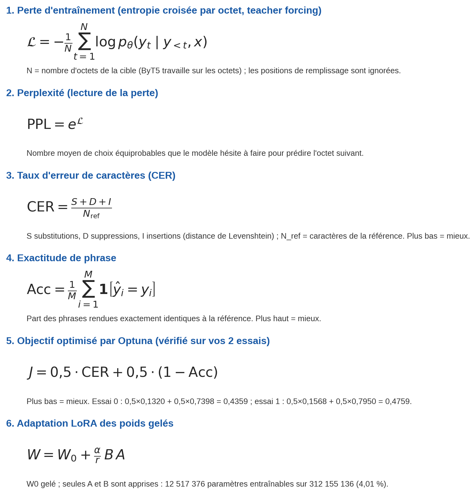


### Évolution des métriques pendant l'entraînement(model avec un seul adaptateur)

Les différentes courbes ci-dessous illustrent l'évolution des métriques au fil des époques d'entraînement de notre modèle fine-tuné avec LoRA, en utilisant **un adaptateur unique pour l'ensemble des jeux de données**.

La figure présente quatre visualisations :

- **(a) Perte d'entropie croisée (*Cross-Entropy Loss*)** : évolution de la perte au cours de l'entraînement.
- **(b) Comparaison des deux essais (0 et 1)** : évolution des métriques selon les époques pour les deux essais.
- **(c) Perte en échelle logarithmique** : représentation de la perte avec une échelle logarithmique afin de mieux visualiser ses variations.
- **(d) Perplexité (*Perplexity*)** : évolution de la perplexité, calculée à partir de la perte, qui permet d'apprécier la capacité du modèle à prédire les séquences.

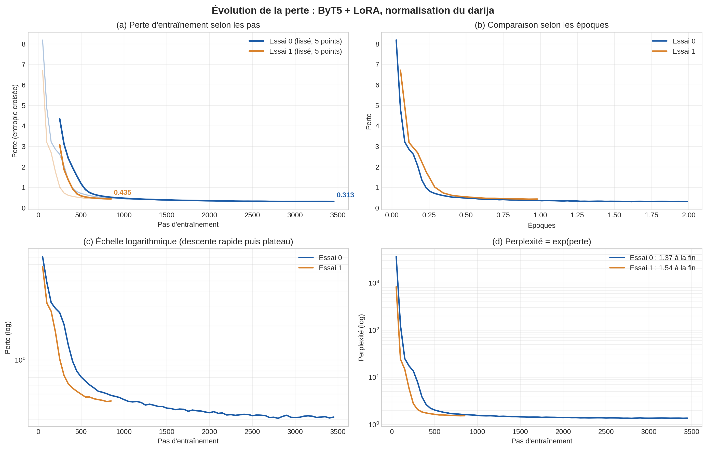

### Évolution des métriques CER, Sentence Accuracy et fonction objectif(model avec un seul adaptateur)

L'histogramme suivant présente une comparaison des performances obtenues lors des deux essais d'entraînement (essai 0 et essai 1), à travers trois métriques :

- **CER** : 0,1320 pour l'essai 0 contre 0,1568 pour l'essai 1.
- **Sentence Accuracy** : 0,2602 pour l'essai 0 contre 0,2050 pour l'essai 1.
- **Métrique objectif** : 0,4359 pour l'essai 0 contre 0,4759 pour l'essai 1.

Ces résultats montrent que l'essai 0 obtient de meilleures performances sur les trois métriques, avec un CER et une fonction objectif plus faibles, ainsi qu'une Sentence Accuracy plus élevée.

Pour examiner plus en détail ces résultats et mieux visualiser les différences entre les deux essais, nous présentons les figures suivantes.

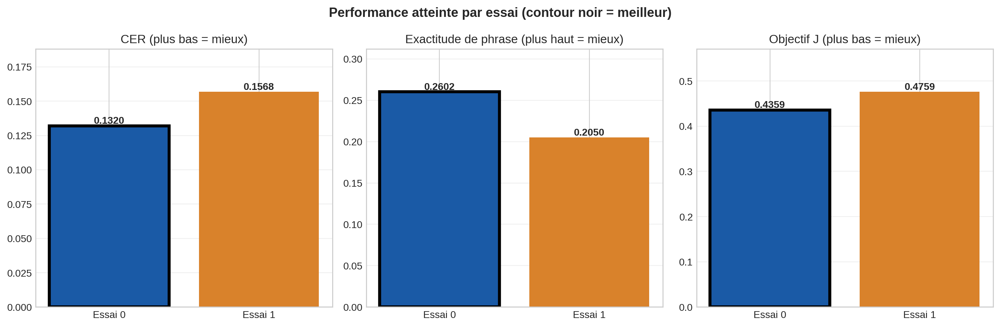

### Résultats finaux et paramètres d'entraînement(model avec un seul adaptateur)

La figure ci-dessous présente une synthèse des résultats obtenus avec notre modèle final. Elle regroupe plusieurs éléments :

- **Perte d'entraînement** : évolution de la loss au cours des étapes d'entraînement.
- **Perte lissée** : représentation lissée de la perte afin de mieux observer sa tendance générale.
- **Métriques finales** : valeurs obtenues pour les différentes métriques d'évaluation, notamment le CER, la Sentence Accuracy et la métrique objectif.
- **Paramètres d'entraînement** : configuration retenue pour le modèle à l'issue de l'entraînement.

Le notebook présente également une recherche automatisée de certains paramètres d'entraînement. La figure met ainsi en évidence la configuration retenue et les résultats obtenus à l'issue de cette expérimentation.

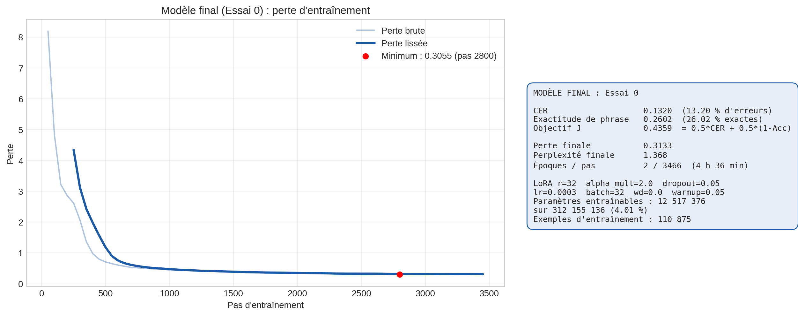

### Synthèse des résultats et configurations expérimentales(model avec un seul adapatateur)

Afin de récapituler les résultats obtenus avec la première approche, basée sur **un adaptateur LoRA unique entraîné sur l'ensemble des jeux de données**, nous présentons ci-dessous trois tableaux complémentaires.

**1. Tableau récapitulatif des métriques**

Ce premier tableau rassemble les performances finales obtenues par le modèle pour les différentes métriques d'évaluation.

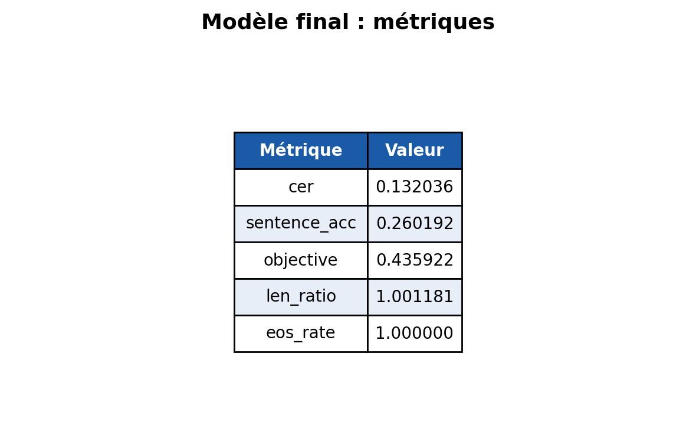

**2. Tableau des configurations d'entraînement**

Ce tableau présente les différentes configurations utilisées pour l'entraînement du modèle, notamment les paramètres retenus pour le fine-tuning LoRA.

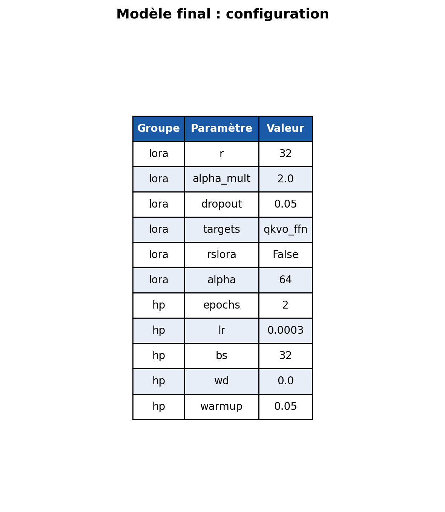

**3. Tableau récapitulatif des essais et de l'optimisation Optuna**

Enfin, ce dernier tableau regroupe les différents essais réalisés, les paramètres explorés et les configurations obtenues à travers la recherche automatisée avec Optuna.


## model a multiple adapatateur

### Évolution des pertes d'entraînement par adaptateur LoRA

La figure ci-dessous présente l'évolution de la perte d'entraînement pour chacun des cinq adaptateurs LoRA indépendants, associés respectivement aux sources **s3, s4, s2, s1 et s5**.

Pour chaque source, le titre du graphique précise le nombre d'exemples utilisés, le nombre d'époques, le nombre de pas d'entraînement ainsi que les métriques finales obtenues : CER, Sentence Accuracy et fonction objectif J.

Le sixième graphique regroupe les courbes des cinq sources afin de comparer leur évolution au fil des époques. Cette représentation utilise une échelle logarithmique pour faciliter la visualisation des variations de perte.

**Résultats clés :** le tableau suivant compare la première valeur de perte enregistrée à la dernière valeur disponible pour chaque source.

| Source | Première perte | Dernière perte enregistrée |
|:---:|---:|---:|
| s3 | 4,914 | 0,3223 |
| s4 | 0,5998 | 0,3585 |
| s2 | 0,2699 | 0,0610 |
| s1 | 0,4278 | 0,2369 |
| s5 | 0,7610 | 0,5890 |

**Points importants pour l'interprétation :**

- La perte est enregistrée tous les 50 pas d'entraînement. Le dernier point affiché correspond donc au dernier relevé disponible et pas nécessairement au dernier pas d'entraînement.
- Seule la perte d'entraînement est disponible dans ces courbes.
- La perte la plus faible est obtenue sur la source s2 (0,0610). Cependant, cela ne signifie pas nécessairement que cet adaptateur possède le meilleur CER, car les caractéristiques et la distribution des données diffèrent d'une source à l'autre.
- Pour la source s5, la perte minimale observée est de 0,5431 au pas 300, avant de remonter légèrement jusqu'à 0,5890 au dernier relevé.

Il convient donc d'interpréter chaque courbe en tenant compte des caractéristiques propres à sa source, plutôt que de comparer directement les valeurs absolues des pertes entre les adaptateurs.

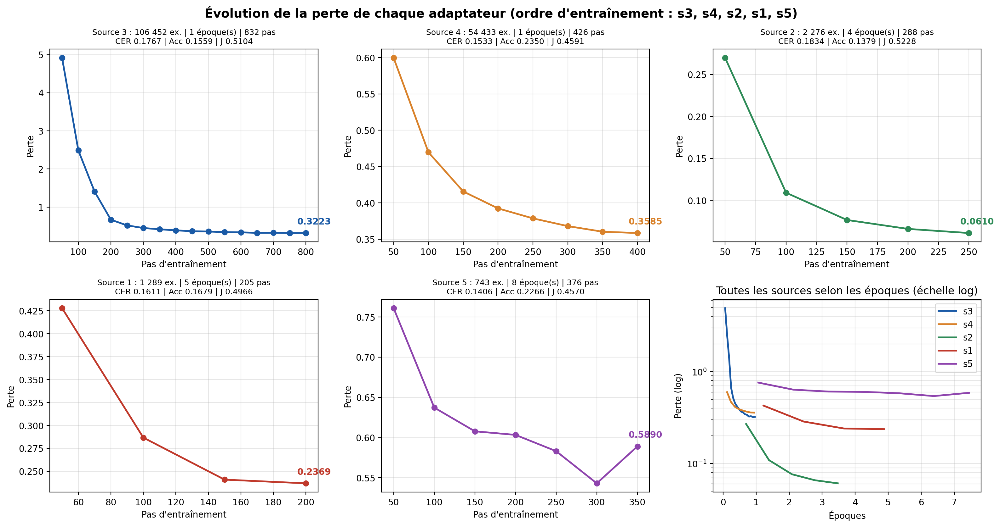

### Pertes comparées des cinq adaptateurs LoRA

**Ce que montre la figure.** Elle présente quatre vues des pertes d'entraînement des cinq adaptateurs :

- **(a)** Évolution de la perte en fonction des pas d'entraînement.
- **(b)** Évolution de la perte en fonction des époques.
- **(c)** Évolution de la perte en échelle logarithmique.
- **(d)** Évolution de la perplexité, calculée comme l'exponentielle de la perte.

**Comment lire les courbes.** La vue (b) permet de comparer les différentes sources selon une même échelle temporelle, allant d'une époque pour s3 et s4 jusqu'à huit époques pour s5. La vue (c) facilite l'observation de la diminution rapide de la perte, suivie d'une phase de stabilisation.

**Résultats clés — perplexité finale :**

| Source | Perplexité |
|:---:|---:|
| s3 | 1,38 |
| s4 | 1,43 |
| s2 | 1,06 |
| s1 | 1,27 |
| s5 | 1,80 |

**À retenir.** Les cinq courbes présentent une diminution rapide de la perte, suivie d'une stabilisation progressive. La source s5, qui contient le moins d'exemples (743), présente la perplexité finale la plus élevée (1,80).

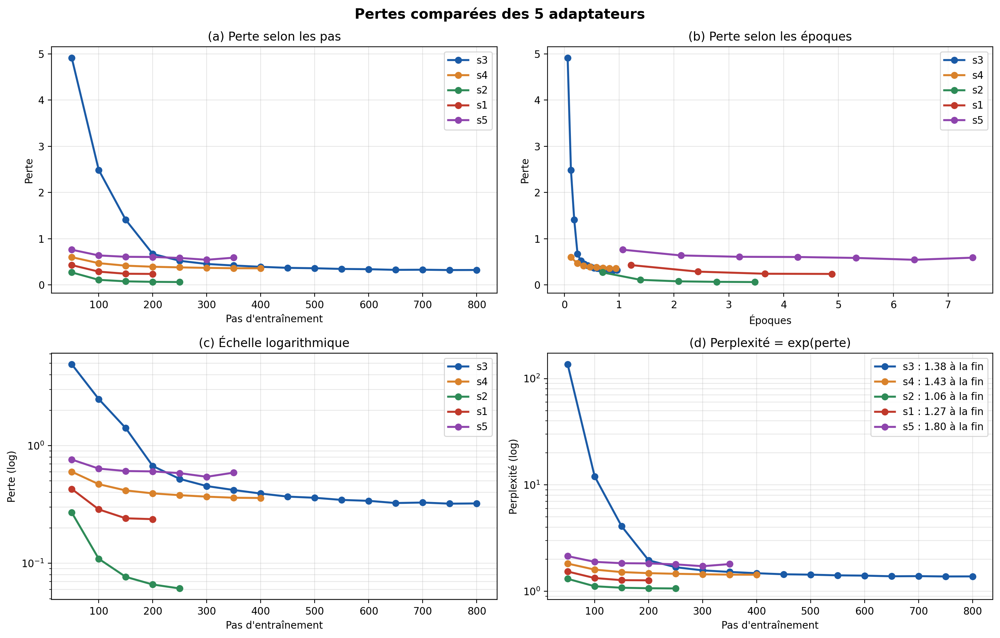


### Image 4 : Performance après chaque adaptateur LoRA

Cette figure présente les performances obtenues après l'entraînement indépendant de chacun des cinq adaptateurs LoRA, à travers trois graphiques en barres représentant le CER, la Sentence Accuracy et la fonction objectif J. Le contour noir permet d'identifier la meilleure valeur pour chaque métrique.

**Résultats clés :**

| Source | CER | Sentence Accuracy | Objectif J |
|:---:|---:|---:|---:|
| s3 | 0,1767 | 0,1559 | 0,5104 |
| s4 | 0,1533 | 0,2350 | 0,4591 |
| s2 | 0,1834 | 0,1379 | 0,5228 |
| s1 | 0,1611 | 0,1679 | 0,4966 |
| s5 | 0,1406 | 0,2266 | 0,4570 |

**À retenir.** La source s5 obtient le meilleur CER (0,1406) ainsi que le meilleur objectif J (0,4570). En revanche, la meilleure Sentence Accuracy est obtenue par la source s4 (0,2350). La source s2 présente les résultats les moins favorables sur les trois métriques.

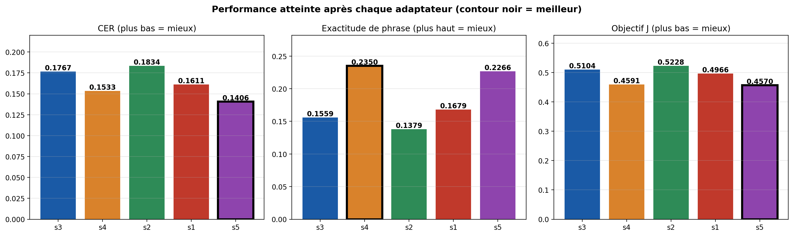

### Image 5 : Croissance du nombre de paramètres du modèle

**Ce que montre la figure.** Elle présente deux graphiques complémentaires : à gauche, l'évolution du nombre total de paramètres du modèle après chaque ajout d'adaptateur LoRA ; à droite, l'évolution de la proportion de paramètres entraînables.

**Résultats clés :**

- Le nombre total de paramètres passe de **312 155 136 à 362 224 640**.
- Chaque adaptateur ajoute **12 517 376 paramètres**, soit environ 12,5 millions.
- Le nombre de paramètres entraînables reste constant à **12 517 376**.
- Leur proportion dans le modèle diminue progressivement de **4,01 % à 3,46 %**.

**À retenir.** L'ajout d'un adaptateur indépendant par source entraîne une croissance linéaire de la taille totale du modèle, avec environ 50 millions de paramètres supplémentaires après les quatre ajouts. Toutefois, le nombre de paramètres entraînables à chaque étape reste constant, puisqu'un seul adaptateur est entraîné à la fois.

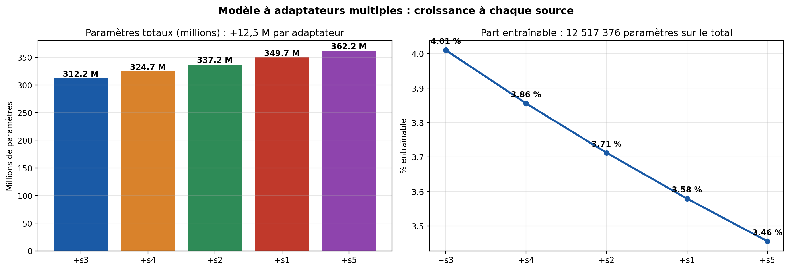


### Image 6a : Tableau récapitulatif de l'entraînement séquentiel

**Ce que montre le tableau.** Cette figure présente les principales informations relatives à l'entraînement séquentiel des cinq adaptateurs LoRA. Chaque ligne correspond à un adaptateur et précise notamment son ordre d'entraînement, la source de données utilisée, le nombre d'exemples, les adaptateurs actifs, le nombre d'époques, les pas d'entraînement, le taux d'apprentissage, la taille du lot (*batch size*), la durée ainsi que les pertes initiale et finale.

**Résultats clés :**

- Les sources les plus volumineuses, s3 (106 452 exemples) et s4 (54 433 exemples), sont entraînées sur une seule époque, avec un taux d'apprentissage de 5e-4 et une taille de lot de 64.
- Les sources de plus petite taille utilisent davantage d'époques et des lots plus réduits : s2 (2 276 exemples) avec 4 époques et un lot de 16 ; s1 (1 289 exemples) avec 5 époques et un lot de 16 ; enfin, s5 (743 exemples) avec 8 époques et un lot de 8.
- Le taux d'apprentissage diminue progressivement selon l'ordre d'entraînement : 5e-4, 5e-4, 3e-4, 2e-4 et 1e-4.
- La durée cumulée des cinq entraînements est de **4 h 32 min**. Le budget global de l'essai complet est estimé à **4,69 heures**, évaluations comprises.

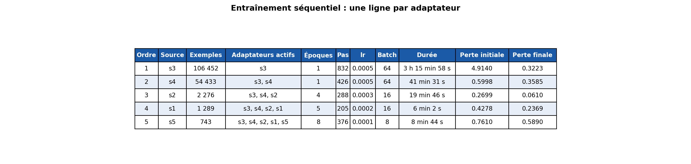


### Image 6b : Tableau récapitulatif de l'évaluation

**Ce que montre le tableau.** Cette figure regroupe les résultats de l'évaluation des cinq adaptateurs LoRA. Pour chaque source, elle présente le CER, la Sentence Accuracy, la fonction objectif J, le rapport entre la longueur prédite et la longueur de référence, le taux de génération du jeton de fin de séquence (EOS), le nombre total de paramètres ainsi que la proportion de paramètres entraînables.

Toutes les évaluations sont réalisées sur un jeu de test commun, nommé `test_clean`, composé de **834 phrases**.

**Résultats clés :**

- Le rapport entre la longueur prédite et la longueur de référence varie entre **0,99 et 1,01** pour toutes les sources.
- Le taux de génération du jeton EOS est de **1,00** pour chaque adaptateur.

**À retenir.** Ces résultats indiquent que les modèles produisent des séquences de longueur globalement conforme aux références et terminent correctement leurs générations. Les erreurs observées semblent donc davantage liées au choix des caractères générés qu'à un problème de longueur ou de terminaison des séquences.

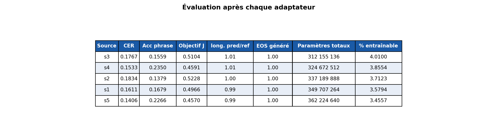

### Images 6c et 6d : Configuration LoRA et métriques du modèle final

| **Image 6c : Configuration LoRA commune** | **Image 6d : Métriques du modèle final** |
|:---:|:---:|
| 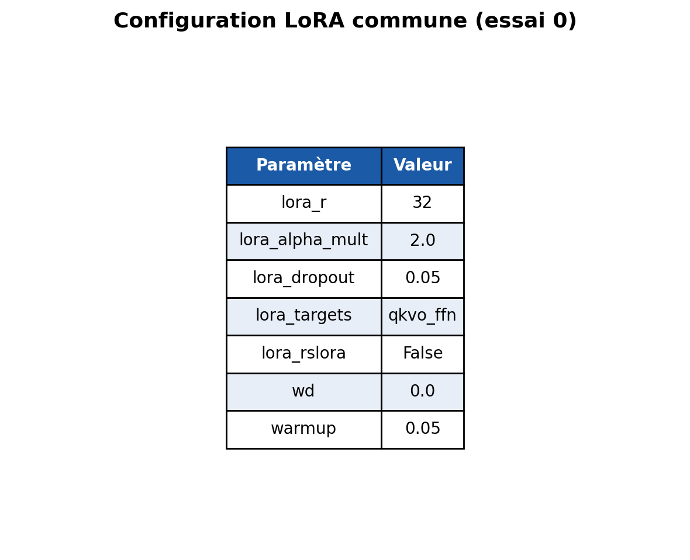 | 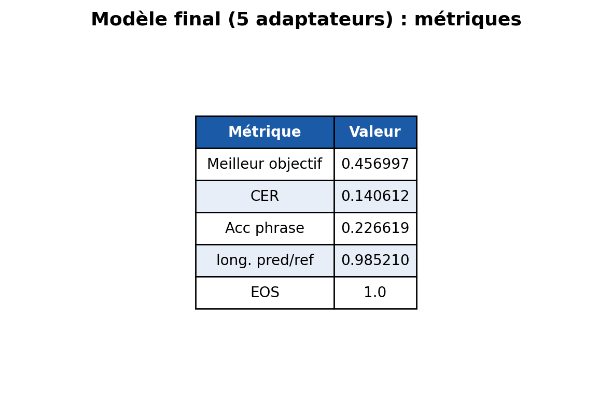 |

**6c — Configuration LoRA commune**

Cette figure présente les paramètres LoRA et d'entraînement retenus par Optuna lors de l'essai 0 et partagés par les cinq adaptateurs.

**Valeurs retenues :**

- Rang LoRA (*r*) : 32
- Multiplicateur alpha : 2,0, soit α = 64
- Dropout : 0,05
- Cibles : `qkvo_ffn` (projections d'attention q, k, v, o et couches feed-forward)
- rsLoRA : désactivé
- Weight decay : 0,0
- Warmup : 0,05

**À retenir.** Une configuration LoRA commune est utilisée pour les cinq sources. Seuls le nombre d'époques, le taux d'apprentissage et la taille des lots varient selon les sources, comme présenté dans l'image 6a.

---

**6d — Métriques du modèle final**

Cette figure présente les cinq métriques finales obtenues avec le modèle intégrant les cinq adaptateurs actifs.

**Valeurs obtenues :**

| Métrique | Valeur |
|---|---:|
| Fonction objectif J | 0,456997 |
| CER | 0,140612 |
| Sentence Accuracy | 0,226619 |
| Rapport de longueur | 0,985210 |
| Taux EOS | 1,000000 |

**À retenir.** Le modèle final présente un taux d'erreur de caractères d'environ **14,1 %**, tandis que **22,7 % des phrases** sont reproduites exactement à l'identique des références. Ces résultats correspondent à l'étude `byt5_darija_lora_v5`, qui comporte un seul essai terminé (essai 0).

### Fiche de synthèse du modèle final

La fiche ci-dessous présente une synthèse des résultats obtenus avec les cinq adaptateurs LoRA. Elle regroupe les principales métriques d'évaluation et les configurations retenues.

| **Tableau 1 : Métriques du modèle final** | **Tableau 2 : Configuration du modèle** |
|:---:|:---:|
|  |  |

**Synthèse du modèle final**

Le modèle utilise cinq adaptateurs LoRA appliqués successivement dans l'ordre suivant : s3, s4, s2, s1 et s5.

Ses principales caractéristiques sont les suivantes :

- **CER :** 0,1406.
- **Sentence Accuracy :** 0,2266.
- **Fonction objectif J :** 0,4570.
- **Configuration LoRA :** r = 32, α = 64 et dropout = 0,05.
- **Paramètres entraînables :** 12 517 376 par adaptateur.
- **Nombre total de paramètres :** 362 224 640.

**Récapitulatif des essais et de l'optimisation Optuna**

Le tableau suivant présente une synthèse des essais réalisés, des paramètres explorés et des configurations retenues au cours du processus d'optimisation.

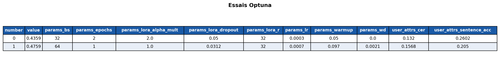

**À retenir.** Cette fiche constitue une synthèse globale de l'approche multi-adaptateurs. Elle permet de retrouver rapidement les performances finales, la configuration LoRA et les résultats du processus d'optimisation.

## Utilisation

À compléter : exemple d'inférence.
