# Adaptateurs LoRA

Cette page documente deux expériences d'affinage de **`google/byt5-small`** par
adaptateurs bas-rang (**LoRA**), avec une quantification 4 bits du modèle de
base (**QLoRA**) pour économiser la mémoire du GPU :

- **un adaptateur unique**, entraîné sur les cinq sources réunies ;
- **cinq adaptateurs**, entraînés successivement, un par source.

Les deux modèles sont publiés dans les dossiers `ModelOneAdaptateur/` et
`ModèleMultipleAdaptateur /` du dépôt Hugging Face.

```{warning}
Ces résultats sont mesurés sur **`test_clean`, 834 phrases**, et non sur les
678 phrases d'évaluation du reste de la documentation. Ils ne se comparent pas
directement aux chiffres de {doc}`evaluation` ni à ceux de {doc}`index`.
```

## Configuration QLoRA

Pour charger le modèle **ByT5** et préparer son entraînement avec **QLoRA** :

```python
import torch
from transformers import (
    AutoModelForSeq2SeqLM,
    ByT5Tokenizer,
    BitsAndBytesConfig
)
from peft import prepare_model_for_kbit_training

MODEL_NAME = "google/byt5-small"  # ou "google/byt5-base"

# bf16 seulement si la carte le calcule nativement (Ampere et suivantes).
# torch.cuda.is_bf16_supported() répond oui sur une T4, par émulation.
USE_BF16 = torch.cuda.is_available() and torch.cuda.get_device_capability()[0] >= 8
COMPUTE_DTYPE = torch.bfloat16 if USE_BF16 else torch.float16

print("Compute dtype :", COMPUTE_DTYPE)

# Configuration de la quantification 4 bits
bnb_config = BitsAndBytesConfig(
    load_in_4bit=True,
    bnb_4bit_quant_type="nf4",
    bnb_4bit_use_double_quant=True,
    bnb_4bit_compute_dtype=COMPUTE_DTYPE,
)

# Chargement du tokenizer
tokenizer = ByT5Tokenizer.from_pretrained(MODEL_NAME)

# Chargement du modèle quantifié
model = AutoModelForSeq2SeqLM.from_pretrained(
    MODEL_NAME,
    quantization_config=bnb_config,
    device_map={"": 0},  # Un seul GPU
)

# Préparation du modèle pour QLoRA
model.config.use_cache = False

model = prepare_model_for_kbit_training(
    model,
    use_gradient_checkpointing=True
)

print(type(model).__name__, "| pad_token_id =", tokenizer.pad_token_id)
print(f"Mémoire modèle : {model.get_memory_footprint()/1e6:.1f} MB")
```

**Remarques techniques :**
- La quantification NF4 réduit la mémoire nécessaire au chargement du modèle.
- La double quantification réduit davantage le coût mémoire.
- BF16 est utilisé lorsque le GPU le calcule nativement (capacité de calcul 8
  ou plus), sinon FP16.
- `prepare_model_for_kbit_training` prépare le modèle quantifié pour
  l'entraînement avec PEFT.
- Le gradient checkpointing réduit la consommation mémoire au prix d'un temps
  de calcul supplémentaire.

La sortie de cette cellule dans le carnet d'origine est reproduite ci-dessous :
449,4 Mo d'empreinte mémoire. Le carnet choisissait alors la précision avec
`torch.cuda.is_bf16_supported()`, d'où `Compute dtype : torch.bfloat16`. Ce test
répond oui même sur une carte sans bf16 natif, comme la T4 de Kaggle, où le
calcul est alors émulé. Le code ci-dessus teste la génération de la carte, comme
le fait `modele/train_byt5.py`.

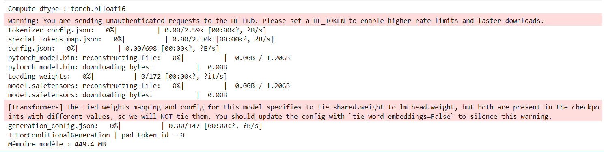

Le carnet de l'entraînement QLoRA contient l'implémentation complète et les
explications associées.

## Entraînement

### Cinq adaptateurs, un par source

Plutôt qu'un affinage unique, le modèle a été affiné **séquentiellement avec
plusieurs adaptateurs**, chacun entraîné sur une source de données.

Les différentes sources sont réparties comme suit :

- Source 1 : 1 289 exemples
- Source 2 : 2 276 exemples
- Source 3 : 106 452 exemples
- Source 4 : 54 433 exemples
- Source 5 : 743 exemples
- Test clean : 834 exemples

Chaque source possède son propre adaptateur, entraîné successivement. Le modèle
final est obtenu par **fusion des adaptateurs**, à travers une sommation
pondérée de leurs poids :

<div align="center">

**W_final = W₀ + α₁ΔW₁ + α₂ΔW₂ + α₃ΔW₃ + α₄ΔW₄ + α₅ΔW₅**

</div>

où :

- **W₀** représente les poids du modèle de base.
- **ΔWᵢ** représente la mise à jour des poids apportée par le i-ème adaptateur.
- **αᵢ** représente le coefficient de pondération associé à chaque adaptateur.

Le jeu `test_clean` (834 exemples) est réservé à l'évaluation finale du modèle
fusionné.

### Un adaptateur unique sur toutes les sources

La deuxième approche entraîne **un seul adaptateur LoRA sur l'ensemble des cinq
sources**, regroupées dans un corpus commun. L'objectif est qu'un adaptateur
unique apprenne les caractéristiques de toutes les sources au cours d'un même
entraînement.

<div align="center">

**W_final = W₀ + ΔW_global**

</div>

où :

- **W₀** représente les poids du modèle de base.
- **ΔW_global** représente la mise à jour des poids apportée par l'unique
  adaptateur LoRA entraîné sur l'ensemble des sources.

On obtient un seul modèle adapté, contrairement à la première approche qui
repose sur cinq adaptateurs indépendants suivis d'une fusion. Le même jeu
`test_clean` sert à l'évaluation, pour comparer directement les deux stratégies.

## Évaluation : adaptateur unique

### Métriques d'évaluation

Pour comparer les deux approches, nous utilisons **Sentence Accuracy** et
**Character Error Rate (CER)**, combinées dans une fonction objectif à
minimiser.

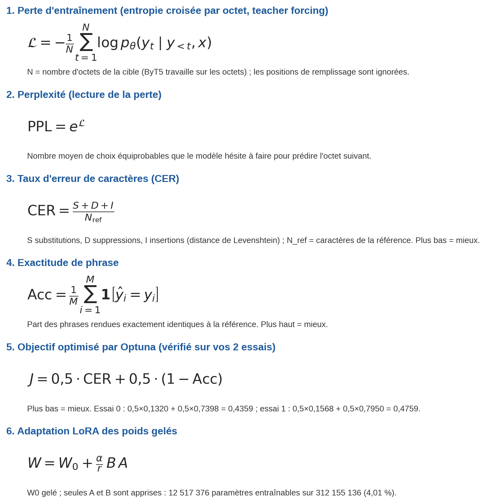

### Évolution des métriques pendant l'entraînement

Les courbes ci-dessous illustrent l'évolution des métriques au fil des époques,
pour le modèle affiné avec **un adaptateur unique pour l'ensemble des jeux de
données**.

La figure présente quatre visualisations :

- **(a) Perte d'entropie croisée (*Cross-Entropy Loss*)** : évolution de la
  perte au cours de l'entraînement.
- **(b) Comparaison des deux essais (0 et 1)** : évolution des métriques selon
  les époques pour les deux essais.
- **(c) Perte en échelle logarithmique** : pour mieux visualiser ses
  variations.
- **(d) Perplexité (*Perplexity*)** : calculée à partir de la perte, elle
  mesure la capacité du modèle à prédire les séquences.

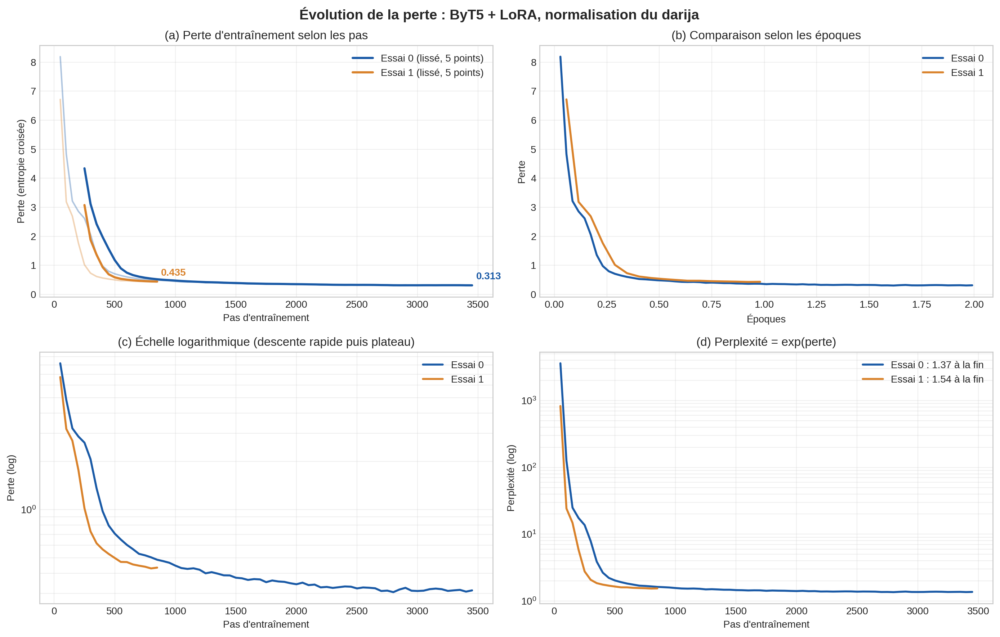

### CER, Sentence Accuracy et fonction objectif

L'histogramme suivant compare les deux essais d'entraînement (essai 0 et
essai 1) sur trois métriques :

- **CER** : 0,1320 pour l'essai 0 contre 0,1568 pour l'essai 1.
- **Sentence Accuracy** : 0,2602 pour l'essai 0 contre 0,2050 pour l'essai 1.
- **Métrique objectif** : 0,4359 pour l'essai 0 contre 0,4759 pour l'essai 1.

L'essai 0 obtient de meilleures performances sur les trois métriques, avec un
CER et une fonction objectif plus faibles, ainsi qu'une Sentence Accuracy plus
élevée.

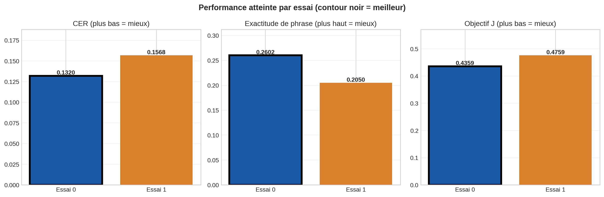

### Résultats finaux et paramètres d'entraînement

La figure ci-dessous synthétise les résultats du modèle final :

- **Perte d'entraînement** : évolution de la perte au cours des pas.
- **Perte lissée** : pour mieux observer sa tendance générale.
- **Métriques finales** : CER, Sentence Accuracy et métrique objectif.
- **Paramètres d'entraînement** : configuration retenue à l'issue de
  l'entraînement.

Le carnet présente également une recherche automatisée de certains paramètres
d'entraînement ; la figure met en évidence la configuration retenue.

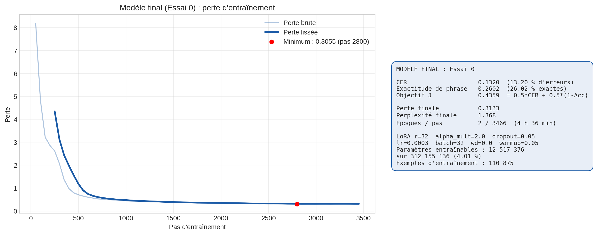

### Synthèse des résultats et des configurations

Trois tableaux récapitulent les résultats de l'approche à **adaptateur LoRA
unique**.

**1. Tableau récapitulatif des métriques**

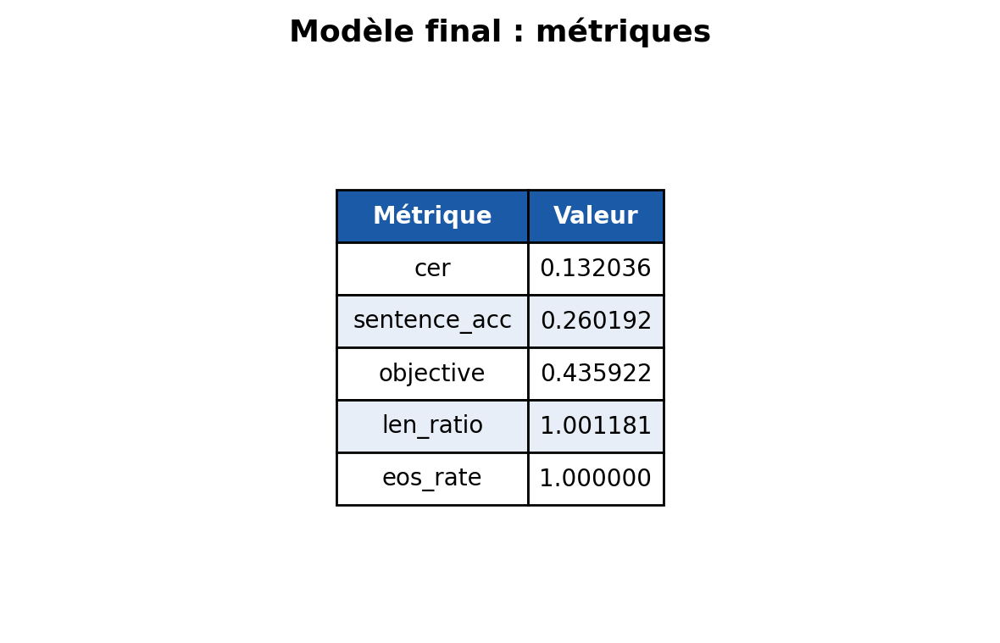

**2. Tableau des configurations d'entraînement**

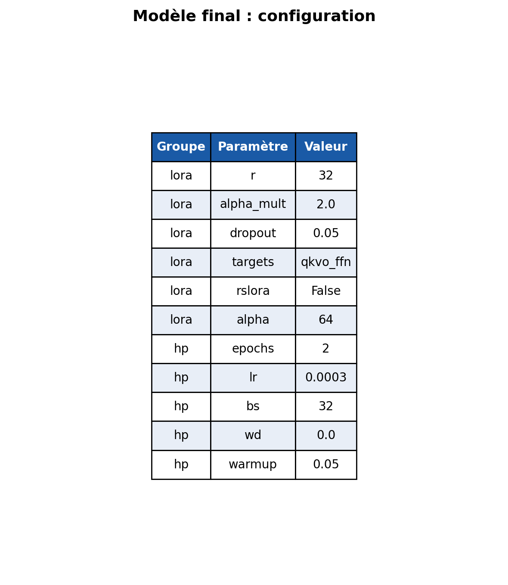

**3. Essais et optimisation Optuna**

Les essais réalisés, les paramètres explorés et les configurations obtenues par
la recherche automatisée avec Optuna.

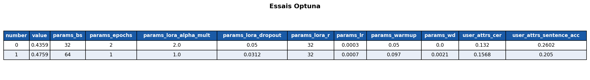

## Évaluation : cinq adaptateurs

### Pertes d'entraînement par adaptateur

La figure ci-dessous présente l'évolution de la perte d'entraînement pour
chacun des cinq adaptateurs LoRA indépendants, associés respectivement aux
sources **s3, s4, s2, s1 et s5**.

Pour chaque source, le titre du graphique précise le nombre d'exemples, le
nombre d'époques, le nombre de pas d'entraînement ainsi que les métriques
finales : CER, Sentence Accuracy et fonction objectif J.

Le sixième graphique regroupe les courbes des cinq sources pour comparer leur
évolution au fil des époques, en échelle logarithmique.

**Résultats clés :** première valeur de perte enregistrée et dernière valeur
disponible pour chaque source.

| Source | Première perte | Dernière perte enregistrée |
|:---:|---:|---:|
| s3 | 4,914 | 0,3223 |
| s4 | 0,5998 | 0,3585 |
| s2 | 0,2699 | 0,0610 |
| s1 | 0,4278 | 0,2369 |
| s5 | 0,7610 | 0,5890 |

**Points importants pour l'interprétation :**

- La perte est enregistrée tous les 50 pas. Le dernier point affiché est donc le
  dernier relevé disponible, pas nécessairement le dernier pas.
- Seule la perte d'entraînement est disponible dans ces courbes.
- La perte la plus faible est obtenue sur s2 (0,0610). Cela ne signifie pas que
  cet adaptateur a le meilleur CER : les données diffèrent d'une source à
  l'autre.
- Pour s5, la perte minimale observée est de 0,5431 au pas 300, avant de
  remonter légèrement jusqu'à 0,5890 au dernier relevé.

Chaque courbe s'interprète donc selon les caractéristiques de sa source, plutôt
qu'en comparant les valeurs absolues des pertes entre adaptateurs.

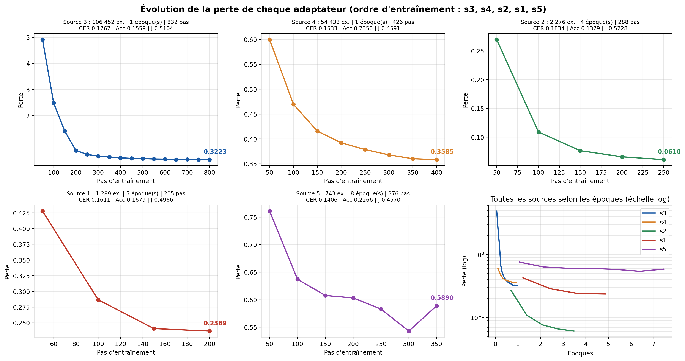

### Pertes comparées des cinq adaptateurs

**Ce que montre la figure.** Quatre vues des pertes d'entraînement des cinq
adaptateurs :

- **(a)** Évolution de la perte en fonction des pas d'entraînement.
- **(b)** Évolution de la perte en fonction des époques.
- **(c)** Évolution de la perte en échelle logarithmique.
- **(d)** Évolution de la perplexité, exponentielle de la perte.

**Comment lire les courbes.** La vue (b) compare les sources sur une même
échelle temporelle, d'une époque pour s3 et s4 jusqu'à huit pour s5. La vue (c)
montre la diminution rapide de la perte, suivie d'une phase de stabilisation.

**Résultats clés — perplexité finale :**

| Source | Perplexité |
|:---:|---:|
| s3 | 1,38 |
| s4 | 1,43 |
| s2 | 1,06 |
| s1 | 1,27 |
| s5 | 1,80 |

**À retenir.** Les cinq courbes diminuent rapidement puis se stabilisent. La
source s5, qui contient le moins d'exemples (743), a la perplexité finale la
plus élevée (1,80).

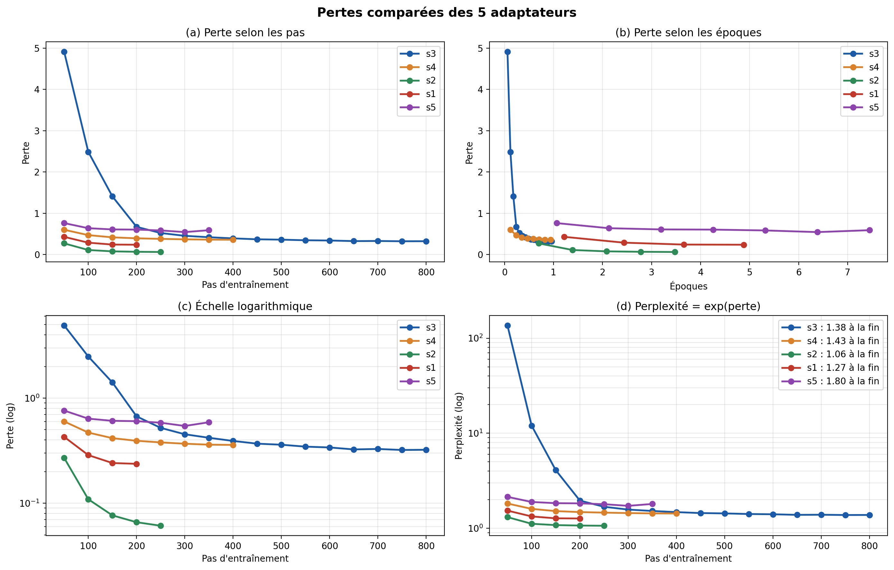

### Performance après chaque adaptateur

Performances obtenues après l'entraînement de chacun des cinq adaptateurs, en
trois graphiques en barres : CER, Sentence Accuracy et fonction objectif J. Le
contour noir signale la meilleure valeur pour chaque métrique.

**Résultats clés :**

| Source | CER | Sentence Accuracy | Objectif J |
|:---:|---:|---:|---:|
| s3 | 0,1767 | 0,1559 | 0,5104 |
| s4 | 0,1533 | 0,2350 | 0,4591 |
| s2 | 0,1834 | 0,1379 | 0,5228 |
| s1 | 0,1611 | 0,1679 | 0,4966 |
| s5 | 0,1406 | 0,2266 | 0,4570 |

**À retenir.** s5 obtient le meilleur CER (0,1406) et le meilleur objectif J
(0,4570) ; la meilleure Sentence Accuracy revient à s4 (0,2350). s2 présente les
résultats les moins favorables sur les trois métriques.

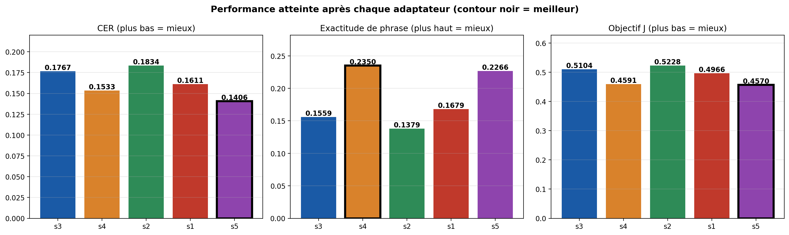

### Croissance du nombre de paramètres

**Ce que montre la figure.** À gauche, le nombre total de paramètres après
chaque ajout d'adaptateur ; à droite, la proportion de paramètres
entraînables.

**Résultats clés :**

- Le nombre total de paramètres passe de **312 155 136 à 362 224 640**.
- Chaque adaptateur ajoute **12 517 376 paramètres**, soit environ 12,5
  millions.
- Le nombre de paramètres entraînables reste constant à **12 517 376**.
- Leur proportion diminue progressivement de **4,01 % à 3,46 %**.

**À retenir.** Un adaptateur par source fait croître linéairement la taille
totale du modèle, d'environ 50 millions de paramètres après les quatre ajouts.
Le nombre de paramètres entraînables à chaque étape reste constant, puisqu'un
seul adaptateur est entraîné à la fois.

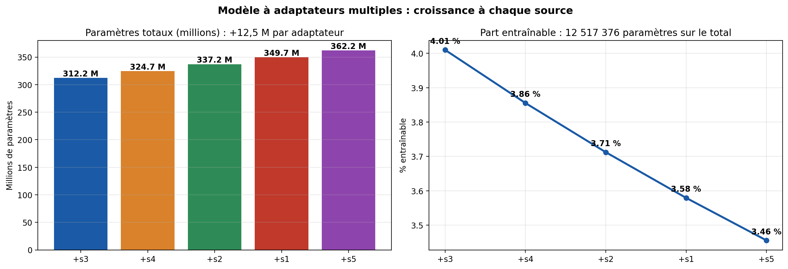

### Entraînement séquentiel : récapitulatif

**Ce que montre le tableau.** Une ligne par adaptateur : ordre d'entraînement,
source, nombre d'exemples, adaptateurs actifs, époques, pas, taux
d'apprentissage, taille de lot, durée, pertes initiale et finale.

**Résultats clés :**

- Les sources les plus volumineuses, s3 (106 452 exemples) et s4 (54 433), sont
  entraînées sur une seule époque, avec un taux d'apprentissage de 5e-4 et des
  lots de 64.
- Les petites sources utilisent davantage d'époques et des lots plus réduits :
  s2 (2 276 exemples), 4 époques, lots de 16 ; s1 (1 289), 5 époques, lots de
  16 ; s5 (743), 8 époques, lots de 8.
- Le taux d'apprentissage diminue selon l'ordre d'entraînement : 5e-4, 5e-4,
  3e-4, 2e-4 et 1e-4.
- La durée cumulée des cinq entraînements est de **4 h 32 min**. Le budget de
  l'essai complet est estimé à **4,69 heures**, évaluations comprises.

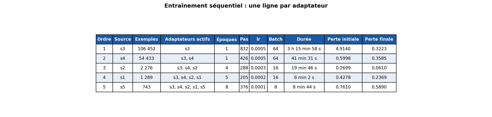

### Évaluation : récapitulatif

**Ce que montre le tableau.** Pour chaque source : CER, Sentence Accuracy,
fonction objectif J, rapport entre longueur prédite et longueur de référence,
taux de génération du jeton de fin de séquence (EOS), nombre total de
paramètres et proportion de paramètres entraînables.

Toutes les évaluations portent sur le même jeu, `test_clean`, de **834
phrases**.

**Résultats clés :**

- Le rapport entre longueur prédite et longueur de référence varie entre
  **0,99 et 1,01** pour toutes les sources.
- Le taux de génération du jeton EOS est de **1,00** pour chaque adaptateur.

**À retenir.** Les modèles produisent des séquences de longueur conforme aux
références et terminent correctement leurs générations. Les erreurs tiennent
donc au choix des caractères générés plutôt qu'à la longueur ou à la
terminaison des séquences.

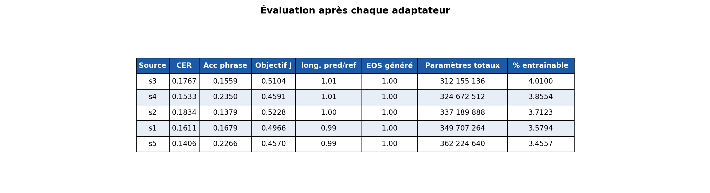

### Configuration LoRA et métriques du modèle final

| **Configuration LoRA commune** | **Métriques du modèle final** |
|:---:|:---:|
| 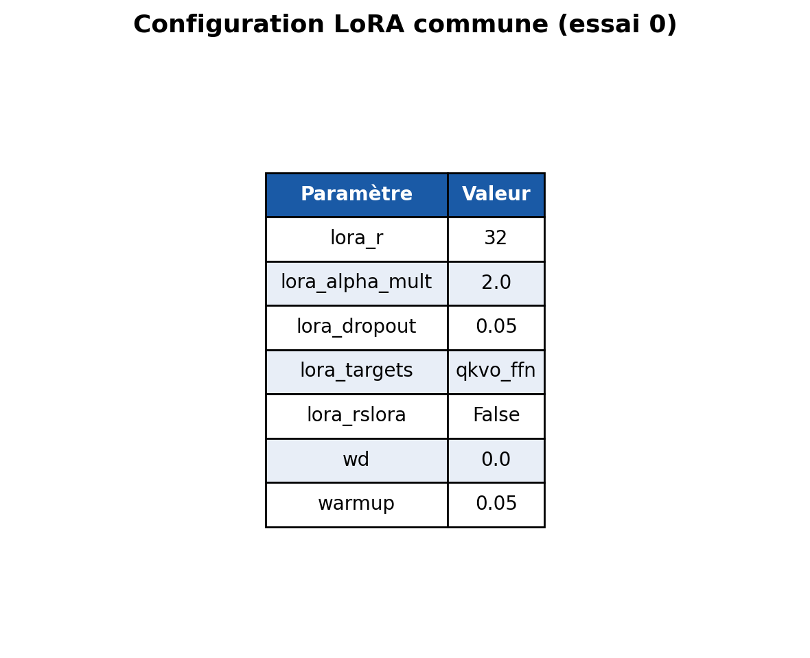 | 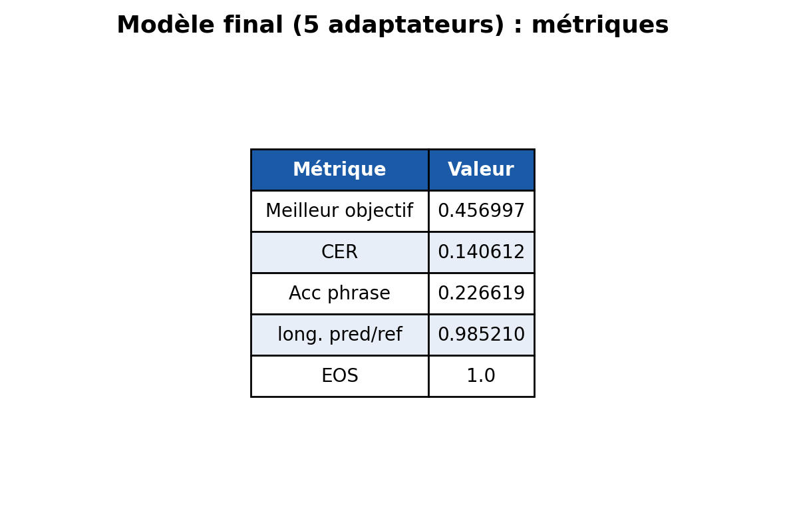 |

**Configuration LoRA commune.** Les paramètres retenus par Optuna à l'essai 0
de l'adaptateur unique (voir plus haut), partagés par les cinq adaptateurs :

- Rang LoRA (*r*) : 32
- Multiplicateur alpha : 2,0, soit α = 64
- Dropout : 0,05
- Cibles : `qkvo_ffn` (projections d'attention q, k, v, o et couches
  feed-forward)
- rsLoRA : désactivé
- Weight decay : 0,0
- Warmup : 0,05

Seuls le nombre d'époques, le taux d'apprentissage et la taille des lots
varient selon les sources, comme le montre le récapitulatif de l'entraînement.

**Métriques du modèle final**, cinq adaptateurs actifs :

| Métrique | Valeur |
|---|---:|
| Fonction objectif J | 0,456997 |
| CER | 0,140612 |
| Sentence Accuracy | 0,226619 |
| Rapport de longueur | 0,985210 |
| Taux EOS | 1,000000 |

Le modèle final a un taux d'erreur de caractères d'environ **14,1 %**, et
**22,7 % des phrases** sont reproduites à l'identique des références. Ces
résultats correspondent à l'étude `byt5_darija_lora_v5`, qui comporte un seul
essai terminé (essai 0).

### Synthèse

Le modèle applique cinq adaptateurs LoRA successivement, dans l'ordre s3, s4,
s2, s1 et s5.

- **CER :** 0,1406.
- **Sentence Accuracy :** 0,2266.
- **Fonction objectif J :** 0,4570.
- **Configuration LoRA :** r = 32, α = 64 et dropout = 0,05.
- **Paramètres entraînables :** 12 517 376 par adaptateur.
- **Nombre total de paramètres :** 362 224 640.

Sur `test_clean`, l'adaptateur unique fait mieux que les cinq adaptateurs :
CER 0,1320 contre 0,1406, Sentence Accuracy 0,2602 contre 0,2266.
